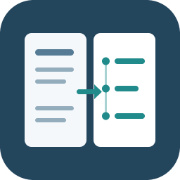
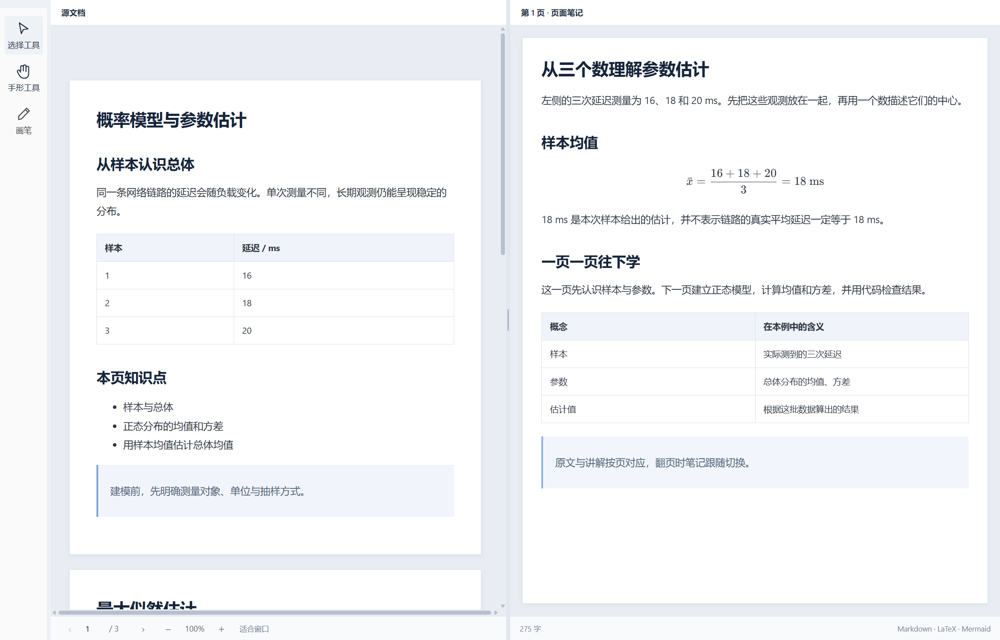
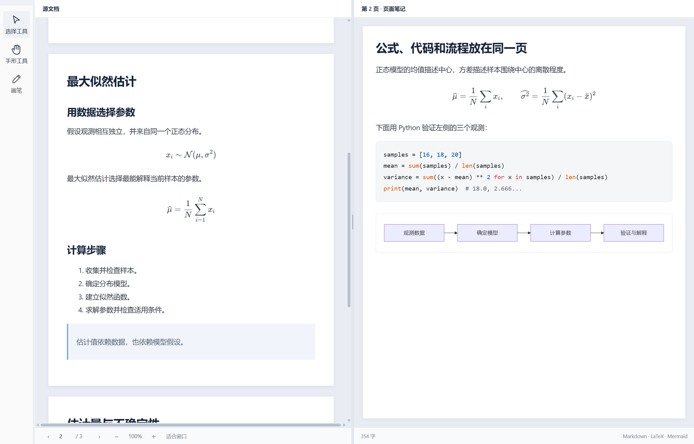

# pagenote



English · [简体中文](README.md)

pagenote puts a document on the left and notes for the current page on the right.

## Where pagenote started

As AI becomes part of everyday life, using it to study is a familiar choice. We give it slides and papers, hoping it will build on what we already know and guide us, step by step, toward an understanding of difficult material.

Yet this way of learning has practical shortcomings. The source and explanation sit in separate windows, and switching between them makes it easy to lose our place. AI sometimes rearranges the material, disrupting the order of the lesson. Asking it to explain an entire document at once can run into context and output limits, producing a summary that skips derivations, unfamiliar notation and examples. We may feel we have understood it, only to struggle when solving a problem or putting it into practice.

These frustrations led to Pagenote. The idea is to keep each source page beside its explanation and give it the attention of a separate request: start from familiar knowledge, fill in the intermediate steps and continue from the preceding page. When something is unclear, select a passage or a figure and leave a request for another example or a different explanation. Notes can be revised as we learn, without repeatedly copying text and explaining the background. Illustrations, runnable code, mathematical notation and flowcharts give AI more ways to make abstract ideas understandable. That was the original purpose of Pagenote.

## Features in pictures

These are real screenshots of the current development build, using original demonstration content. The interface shown is in Chinese.

### Read the source beside its explanation

The left pane shows the document; the right holds Markdown notes for the active page. Notes follow page changes, and each pane scrolls independently. Read PDF and Markdown directly; Word and PowerPoint conversion uses locally installed Microsoft Office.



### Formulas, code and diagrams

Notes support LaTeX, syntax-highlighted code, Mermaid diagrams, tables and pasted images. Keep derivations and verification code on the same page, with the results rendered for reading.

Code highlighting runs locally, without downloading grammars. If rendering fails, include the app version, a minimal code block and a screenshot in your report; see the [rendering notes](docs/CODE-RENDERING.md).



### Expand the editor when needed

Choose the notes pane from the editing menu to expand it and reveal its tools. Edit rendered content directly, with code highlighting updating as you type. Source edits for Word, PDF and PowerPoint open in the system default app; save and return to refresh the preview.


### Leave feedback where it belongs

Select text or an area and add an AI annotation, such as “Add an example here” or “Explain this in words before introducing the formula.” A movable panel opens in the same pane.


Annotations collect in a workbench for the corresponding pane. You can also record requests about the whole document. Double-click a marker to open its workbench, or right-click to delete it. A connected AI client can read the requests through MCP and revise the notes.


Pagenote currently supports two-pane reading, page-linked notes and AI annotations. Its MCP interface lets AI read and edit page content. The app does not include a model; detailed page-by-page explanations and image generation require an AI client with the relevant capabilities.

Follow the [page-by-page teaching workflow](docs/MCP.en-US.md#page-by-page-teaching): make a separate generation request for each page, give it sufficient current-page context and carry a concise knowledge handoff into the next request. Do not generate a whole chapter and split it into pages afterward.

**Current public version: 2.0.0-beta.4.** It is still a beta. Try it with something you are actually learning, and let me know where it gets in your way.

## Download and install

[Windows x64 installer](https://github.com/laihong06/pagenote/releases/download/v2.0.0-beta.4/pagenote-2.0.0-beta.4-windows-x64-setup.exe) · [Complete Windows ZIP](https://github.com/laihong06/pagenote/releases/download/v2.0.0-beta.4/pagenote-2.0.0-beta.4-windows-x64.zip) · [Release notes and checksums](https://github.com/laihong06/pagenote/releases/tag/v2.0.0-beta.4)

1. Download `pagenote-VERSION-windows-x64-setup.exe` from this repository's **Releases**. **Code → Download ZIP** contains source code, not an installer.
2. Run the installer and choose a location. Installation is per user and normally does not require administrator privileges.
3. Launch **pagenote** from the desktop or Start menu.
4. Choose Simplified Chinese or English under **Settings → Language / 语言**.

Alternatively, extract the complete Windows ZIP distribution and run `pagenote.exe`. Keep its accompanying resources together.

Releases should include `SHA256SUMS.txt` and pass security review. The current local build has no publisher signature. If security software blocks it, stop and report the detection; **do not disable protection or add an exclusion**.

## Other controls

- **Hand** pans the page. **Pen** provides ink, highlighting and erasing.
- Ctrl + mouse wheel zooms the current pane. Notes zoom changes the displayed font size.
- Notes follow the active source page as page boundaries cross the viewport midpoint. Page-transition animation can be disabled in settings.
- Automatic note history and restore. Projects, ink and annotations stay on the local machine.
- Data shared with an external AI client is governed by that client's privacy policy.

## Portable projects

Create a project using **File → New project** and choose its name and folder:

```text
My project/
  project.pagenote          # JSON manifest with relative links
  src/
    left.md                # Source: may become left.pdf, left.docx, etc.
    right.md               # Page notes separated by <!-- pagebreak -->
    assets/                # Images and attachments
    annotations.json       # Ink, created when used
    ai-reviews.json         # AI annotations, created when used
```

With the installed app, double-click `project.pagenote`, or choose it under **File → Open project**. For a ZIP distribution without an association, run `register-project-files.cmd` in the newer distribution folder once. Register again after moving the app. If Windows already has another default, choose pagenote under **Open with**.

Legacy `project.page-notes.json` files remain supported through the app. The `left` and `right` links are read on opening. Move the complete folder, not just its manifest.

The brand is now pagenote. When the legacy document store exists and the new document store does not, data is copied while preserving the legacy folder. Existing projects do not need to be renamed or rebuilt.

Beta.3 fixes migration, staged file replacement and cross-volume copy failures in some encrypted or redirected Windows data folders. Interrupted copies retain recovery files; these fallback paths cannot offer the same power-loss guarantees as atomic renames.

## Requirements

- Windows 10/11 x64. Other platforms and ARM64 are not yet validated.
- Office is optional for PDF/Markdown; Word/PPT conversion requires Microsoft Office.
- The distribution includes the Node.js runtime used by MCP. End users do not need a Node.js installation.

## Build from source

Install Node.js 22.13 or newer, then run:

```powershell
npm ci
npm run build
npm run desktop
```

Use `npm run dev` for browser development, `npm run package:desktop` for the Windows installer and ZIP, or `npm run package:dir` for a folder build.

See the [release guide](docs/RELEASING.en-US.md), [terminology specification](docs/TERMINOLOGY.md) and [release-readiness report](docs/RELEASE-READINESS.md). Bug reports should include the version, Windows version, reproduction steps and redacted logs. Do not upload private projects or MCP connection keys.

## License

[MIT License](LICENSE), including commercial use. Dependencies have separate licenses; retain `THIRD-PARTY-NOTICES.txt`, the Node.js license and Electron/Chromium license files when distributing. Microsoft Office licensing is the user's responsibility.

MCP integration: [English](docs/MCP.en-US.md) · [中文](MCP接口说明.md)

Editor and icon changes: [reference](docs/EDITOR-REFERENCE.md).
Standalone imports edit the managed local copy; projects edit the linked file in `src`. Save, then return to pagenote.
