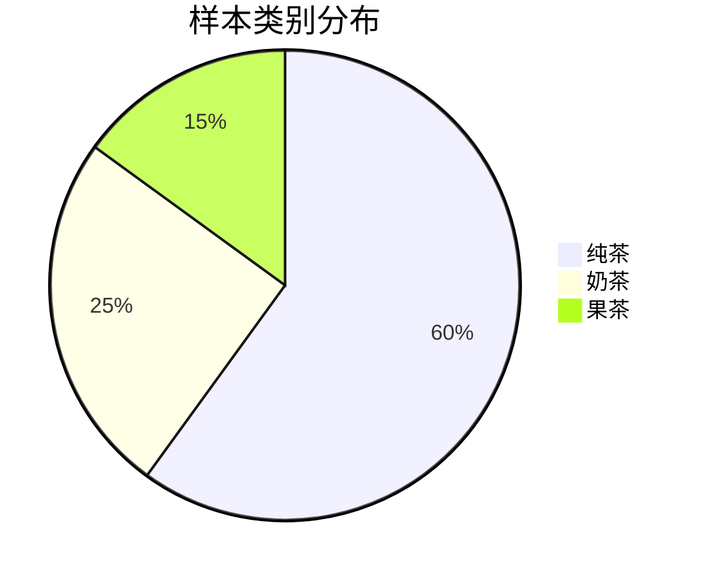
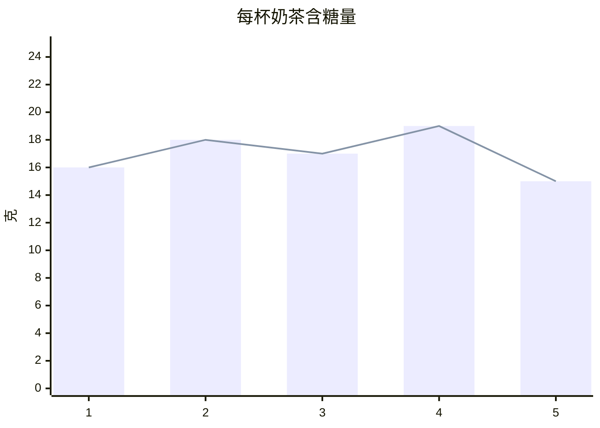
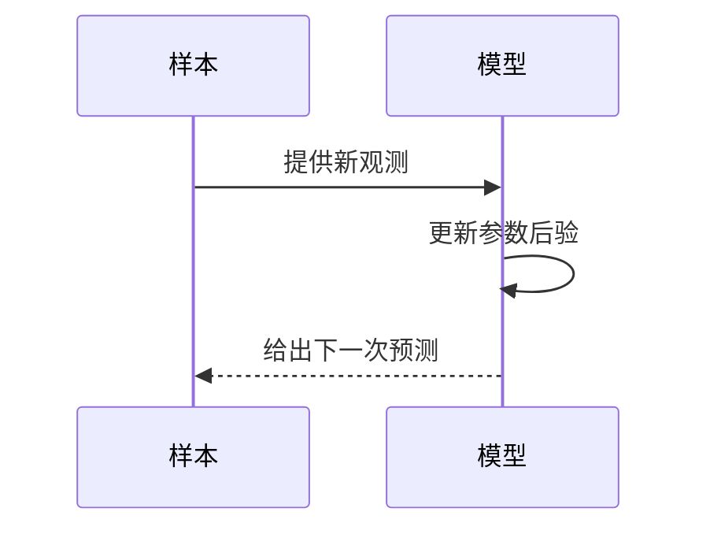

# Markdown 功能示例

## 公式

行内公式：$x\sim\mathcal N(\mu,\sigma^2)$。

$$
\hat\mu=\frac1N\sum_{i=1}^N x_i,
\qquad
\hat\sigma^2=\frac1N\sum_{i=1}^N(x_i-\hat\mu)^2
$$

也支持聊天中复制的公式：\(\mu=18\)，以及独立公式 \[\sigma^2=3.6\]。

## 流程图


## 图表





## 时序图



## 基本排版

**重点**、*斜体*、~~删除线~~、`行内代码`。

> 每一页都有独立笔记，右侧可以持续向下书写。

- 普通列表
- 支持嵌套
  - 子项

1. 估计均值
2. 估计方差

- [x] 理解最大似然估计
- [ ] 复习贝叶斯估计

| 方法 | 使用的信息 |
| --- | --- |
| 最大似然 | 观测样本 |
| 贝叶斯 | 先验和观测样本 |

```python
samples = [16, 18, 17, 19, 15]
mean = sum(samples) / len(samples)
print(mean)
```

## 图片

复制截图后，在右侧笔记区域按 **Ctrl＋V**。也可以拖入图片，或者使用工具栏的“插入附件”。图片自动存储到本机，切页和重新启动后可以继续显示。
